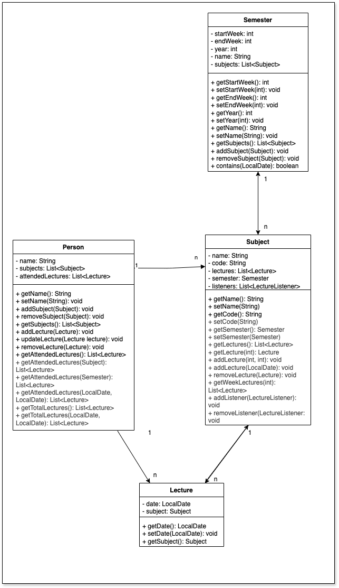

## Applikasjon for oversikt over oppmøte
Denne applikasjonen er et verktøy for å holde oversikt over enkeltpersoners oppmøte i forelesninger. Informasjonen vises for brukeren ukesvis.

De ulike klassene til programmet for datalagring er *Semester, Fag, Forelesning og Person*, det er egne sider for å legge til, slette eller redigere på hver av dem. 

Det er i tillegg en klasse som implementerer grensesnittet Comparator for å sortere forelesninger etter dato og et egetlaget grensesnitt LectureListener for å bruke observatør-observert teknikken.

## Diagram
Jeg valgte å lage et klassediagram over de fire klassene Semester, Subject, Lecture og Person

## Spørsmål
1. Hvilke deler av pensum i emnet dekkes i prosjektet, og på hvilken måte? (For
eksempel bruk av arv, interface, delegering osv.)

    > Det blir tatt i bruk to grensesnitt, både et innebygd et og et egetlaget et. Det er også brukt en god del streams i ulike deler av koden, spesielt med handlinger som skal gjelde mange personer/fag/forelesninger.

2. Dersom deler av pensum ikke er dekket i prosjektet deres, hvordan kunne dere brukt
disse delene av pensum i appen?

    > Jeg har ikke brukt noe særlig arv, men jeg kunne kanskje hatt noe form med Lecture og Subject klassen, ettersom de er tett koblet opp og har mye av den samme informasjonen. Lecture er som en instans av Subject med dato

3. Hvordan forholder koden deres seg til Model-View-Controller-prinsippet? (Merk: det
er ikke nødvendig at koden er helt perfekt i forhold til Model-View-Controller
standarder. Det er mulig (og bra) å reflektere rundt svakheter i egen kode)

    > Store deler av applikasjonens design og layout er laget i SceneBuilder som diverse FXML-filer. Det er likevel diverse objekter som blir laget i kontrolleren og injecta inn i applikasjonen i ettertid, ettersom den må være dynamisk basert på informasjonen som eksisterer i fila. Dette omhandler ting som knappene for å registrere oppmøte og store deler av "rediger" siden.  
    Etter prinsippet kan det være litt for mye logikk i enkelte av kontrollerklassene siden det er flere metoder som er deklarert der. Samtidig er det vanskelig å flytte dem ut, siden det er metodene som genereres basert på knappene generert.

4. Hvordan har dere gått frem når dere skulle teste appen deres, og hvorfor har dere
valgt de testene dere har? Har dere testet alle deler av koden? Hvis ikke, hvordan
har dere prioritert hvilke deler som testes og ikke? (Her er tanken at dere skal
reflektere rundt egen bruk av tester)

    > Har testet setters og getters i de ulike datalagrende klassende for å sørge for at informasjonen lagres riktig og at den valideres ordentlig, i tillegg til å teste fillagring og lesing. Hadde jeg hatt mer tid eller laget tester fra starten av hadde jeg nok laget noe bedre tester, ettersom de jeg har alle ble laget in a rush mot slutten av prosjektet

## KI Deklarasjon
Det har blitt brukt ganske lite KI i utviklingen av dette programmet. Jeg har hovedsakelig brukt StackOverflow, w3Schools og geeksforgeeks og eventuelt andre sider som dukker opp. 

Jeg brukte litt KI til å hjelpe meg med å lage en CustomMenuItem og ChoiceBox i FXML, fordi dokumentasjonen var noe forvirrende.  
Det kan også være at jeg har brukt enkelte automatisk genererte svar som har dukket opp når jeg har søkt, men har generelt ungått dem.

